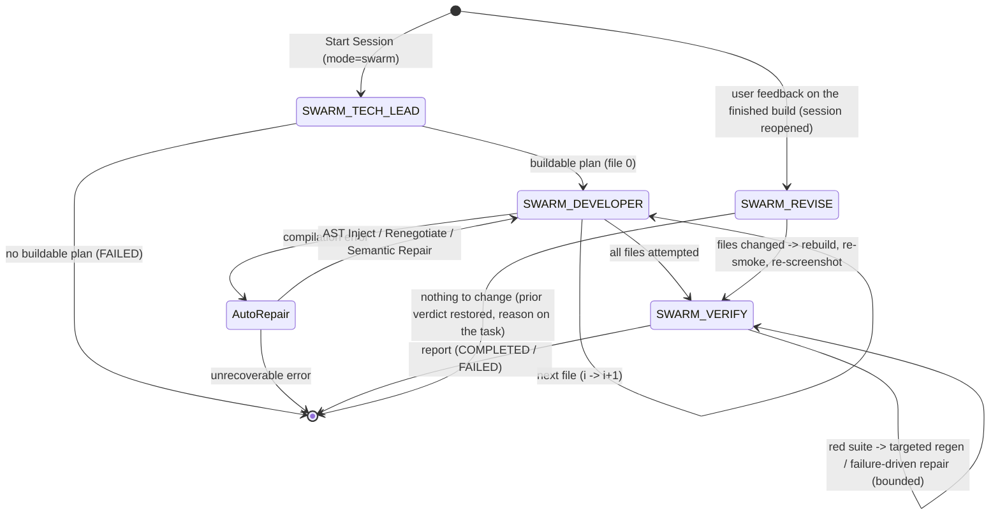

# Swarm Agent Design

This document details the architecture and flow of `SessionMode.SWARM` in
the CGX (`cgx`) framework. Swarm is a **plan-driven, one-file-at-a-time**
build engine: rather than a free-form agent loop, a Tech Lead authors a
validated plan, a Developer implements exactly one planned file per turn in
dependency order, and a Verifier gates the whole tree. Every stage follows a
**propose-then-validate** contract -- the model proposes, deterministic
invariants (coherence, toposort, contracts, syntax) enforce.

## Overview
The workflow is split into three router-driven roles:
1. **Tech Lead (`SWARM_TECH_LEAD`)** -- authors and validates the build plan.
2. **Developer (`SWARM_DEVELOPER`)** -- generates one planned file per turn,
   grounded on the on-disk content of its dependencies.
3. **Verifier (`SWARM_VERIFY`)** -- runs the graded verification ladder over
   the finished tree.

## Router State Machine
The routing loop (`src/cgx/session/router.py`) controls the lifecycle. The
Developer chain is a linear walk over the plan's topologically-ordered files
(one task per file), not a Tech Lead round-trip per file.



- `--mode swarm` seeds the session with a `SWARM_TECH_LEAD` root task.
- `_swarm_tech_lead_to_successors`: a buildable plan spawns `SWARM_DEVELOPER`
  for file 0; an empty/unbuildable plan (`file_count == 0`) goes terminal FAILED.
- `_swarm_developer_to_successors`: chains file *i* -> *i+1* until every planned
  file is attempted, then spawns a single `SWARM_VERIFY`.
- `SWARM_VERIFY`: executes AST-driven AutoRepair (missing imports and logic errors)
  using dynamic temperature scaling, and falls back to dynamic regeneration for structural logic.
- Terminal session actions set COMPLETED when no `failed_paths` remain, else
  FAILED; `on_task_failed` ends a SWARM session FAILED.
- **Feedback loop.** A message posted to a SWARM session that already holds a
  build (`cgx.session.revise.latest_build`) is a *revision*, not a new
  objective: `on_user_message` spawns `SWARM_REVISE` (top-level, "Apply
  feedback #n") and reopens a COMPLETED/FAILED session to ACTIVE. A revision
  that changed files chains to `SWARM_VERIFY`, whose report carries the
  `revision_artifact_id`; one that changed nothing restores the session's
  prior status and stamps the reason on the task. A question-shaped message
  without change words ("how does the login work?") still routes to
  investigation; a message while the build is mid-chain yields an empty plan,
  which the web route turns into `409` and the CLI into an error, so a build
  is never forked. See *Feedback loop* below.

## Tech Lead -- propose-then-validate planner
**File:** `src/cgx/session/tasks/swarm_tech_lead.py`

1. Prompts the provider for a draft JSON plan (files, `depends_on` edges,
   per-file `contracts`).
2. `normalize_plan` (dedupe + prune dangling edges) -> `ordered_paths`
   (shared Kahn toposort, `toposort_manifest_files`) -> `plan_is_buildable`
   gate, with a bounded **3-attempt** corrective re-ask on an unbuildable draft.
3. **Deterministic completeness injection** (`swarm_plan.py`) runs *after*
   normalization, so structural completeness is a guarantee rather than a
   request a weak model may decline:
   - `ensure_scaffolding` appends any missing `README.md`, dependency manifest
     (`requirements.txt` / `pyproject.toml`), and -- for a `src/` layout -- a
     root `conftest.py`. `README.md` and `requirements.txt` are given a
     `depends_on` of every planned `.py` so they are generated last, after the
     sources they describe and scan exist on disk.
   - `ensure_test_coverage` injects a `tests/test_<module>.py` (depending on
     that module) for every source module no planned test already covers, so a
     plan can never ship with zero or partial test coverage.
4. `verify_plan` is the final pre-flight gate: it rejects unsafe/absolute/
   escaping paths, a plan with no buildable source, a dependency cycle, an
   orphan test with no target module, and (via `_scaffolding_problems`) a plan
   still missing README / manifest / conftest. Concrete problems are appended
   to the re-ask; an empty list means the plan is fit for the Developer chain.
5. Persists a `WORK_PLAN` artifact (`goal`, `layers`, `contracts`, ordered
   `paths`, `project_root`) and emits `{work_plan_artifact_id, swarm_paths,
   file_count}`.

## Developer -- incremental generation ladder
**Files:** `swarm_developer.py`, `swarm_generate.py`, `swarm_ground.py`

Each Developer task implements exactly one file (`file_index` into the plan):
1. **Ground** the file's `depends_on` from their *real on-disk content*
   (`swarm_ground`: `describe_file` / `file_skeleton` / `list_symbols` /
   `get_signature`), so generation sees the actual sibling symbols.
2. **Route by kind** (`generate_file`): a non-source planned file is not put on
   the Python ladder. `requirements.txt` and `conftest.py` are emitted from
   deterministic, source-derived templates and `README.md` from a grounded
   free-form call, so scaffolding never has to survive an `ast.parse` gate.
3. **Generate ladder** (source `.py` only): full-file
   (`generate_single_scaffold_file`, gated on `ast.parse` / `syntax_ok`, one
   re-ask) -> deterministic `ASTAssembler` header + per-symbol path, with the
   required symbols derived from the plan `contracts`; empty / symbol-less
   modules are rejected. Three additional auto-repair mechanisms run here:
   - **AST Import Injector**: Identifies missing standard library or first-party
     imports and injects them directly into the AST, bypassing the LLM.
   - **Contract Renegotiation**: If a signature changes during implementation,
     the contract is dynamically renegotiated rather than failing the build.
   - **Semantic Repair Fallback**: For more complex logical errors, a targeted
     fallback repair is attempted.
   - **Phantom-import gate** (`import_audit.py`): a provably-unused, non-side-
     effecting import fails the file (re-ask, then strip as a last resort).
   - **No-stub gate** (`_contract_stub_symbols` / `_body_is_stub`): a contract
     function or method pinned to this module whose body is a placeholder
     (`pass` / `...` / docstring-only / `raise NotImplementedError`) is
     rejected with a hardened re-ask naming the offenders.
4. **Write**: `edit_file` for a greenfield (new) file; `patch_file` +
   `query_codebase` seeding for a brownfield (existing) edit.
5. Emits per-file progress beats and a structured per-turn log; outputs
   `{file_index, path, file_ok, failed_paths}`. `failed_paths` is threaded
   along the chain into `SWARM_VERIFY`.

## Verifier -- graded verification ladder
**File:** `src/cgx/session/tasks/swarm_verify.py`

The ladder moves from fast static analysis to slow dynamic execution:
1. **Static structural checks** (via `scaffold_validate` helpers): coverage
   gaps (a planned test module that parses but defines no collectible test is a
   gap), first-party import coherence, a cross-file **circular-import** gate
   (reusing the AST/SCC detector — a routes↔app / model↔app cycle that pytest
   cannot even collect now fails fast and names a file to regenerate, instead of
   the one-file-at-a-time repair loop that can never break a 2-node cycle), the
   active **skills' `validate_scaffold`** verdicts (stack-specific structural
   checks — e.g. Flask's circular-import / undeclared-extension checks — now run
   on the Swarm path, not just greenfield), and contract compliance. Named files
   drive a bounded targeted regeneration (`_MAX_VERIFY_ROUNDS`) before the
   dynamic step.
2. **Environment dry-run** (only when hard structural checks pass):
   `preflight_install` to satisfy missing dependencies, then
   `run_tests_on_disk` over the impacted tests.
3. **Failure-driven repair** for a structurally-clean tree whose suite is
   nonetheless red -- the defect the static gates cannot see:
   - `ImportError` / `ModuleNotFoundError` are parsed from the pytest output
     and mapped to the *planned* file expected to provide the missing module
     (`_dynamic_regen_targets`), never widening the blast radius to a stray
     dependency frame.
   - The red suite's own output plus the implicated file bodies are threaded
     through `generate_repair_files`, which diagnoses the concrete failure and
     returns corrected complete files -- the step that turns "detected the
     failure" into "produced working code". Only files it actually rewrote and
     that pass a per-language syntax check are written back; if it declines, a
     single blind regeneration of the import targets is the fallback.
   - The repair prompt is allowed to fix **either side** of the contract: when
     a test asserts a fabricated magic literal the goal never specified, or
     calls the source with arguments/attributes it does not accept, the
     repairer rewrites *that test* (asserting an invariant or round-trip
     against the real API) instead of forcing the source to emit an impossible
     value.
   - `check_contract_compliance` resolves a dotted `Class.method` contract
     against the generated class's method set, so a passing, correct tree is no
     longer failed by a false "not defined" warning. Contract warnings are
     *soft*: they never suppress the pytest-driven repair loop.

Test authoring is disciplined at the source: `_SINGLE_FILE_SYSTEM` instructs
the model to call imported code only with argument values it accepts,
construct all inputs inline / via `tmp_path` (never read an external data file
that will not exist when the suite runs), and assert invariants and
round-trips (`decode(encode(x)) == x`, length/ordering properties, idempotence)
rather than fabricated magic literals -- a general discipline, not a
symptom-specific negative directive.

It writes a `SWARM_VERIFY_REPORT` artifact (`coverage_gaps`, `import_warnings`,
`contract_warnings`, `regen_rounds`, `dynamic_regen_rounds`, the env dry-run
outcome, and `verify_ok`) identifying the specific files implicated by any
static or dynamic failure.

## Feedback loop -- review, revise, re-verify
**Files:** `src/cgx/session/revise.py` (pure core), `src/cgx/session/tasks/swarm_revise.py`
(executor), router edges in `router.py`, UI in `frontend/src/components/agent/BuildResult.tsx`.

A build is rarely right the first time, and a user's feedback is rarely a
file name: *"make the top bar span the full width"*, *"the Send button should
be level with the textarea"*, *"remember the API key after a reload"*, *"why is
the settings page blank?"*. The loop the swarm closes is

```
user asks -> swarm builds -> user reviews (screenshots, live preview)
          -> user gives feedback -> SWARM_REVISE knows exactly WHERE + HOW to apply it
          -> SWARM_VERIFY rebuilds, re-smokes, re-screenshots -> user reviews again ...
```

**1. Localize deterministically** (`revise.rank_files`). Every planned file is
scored against the feedback with evidence, each hit carrying a reason that is
shown in the report:

- the feedback names the file, its stem words (`TopBar.jsx` <- "top bar",
  `SettingsForm.jsx` <- "settings form") or an exported symbol;
- it names a route or screen ("settings page", "/settings", "main page") ->
  the files that implement that `<Route>` (routed component first, its
  first-party imports as a second ring);
- a quoted string or Capitalised word appears as UI copy in the file
  ("the 'Send' button");
- a concern keyword maps to a file *role* from the design brief: visual words
  -> the app stylesheet, navigation words -> the shell, connection words ->
  the API client, "remember after reload" -> the storage helper, "readme" ->
  `README.md`, build/dependency words -> `package.json`;
- a structural element word ("header", "composer", "textarea") -> the
  components that render it; generic ones ("button") only break ties;
- a problem report ("blank", "crash", "error") -> the files behind the routes
  the last runtime smoke flagged;
- weak: overlap with the file's planned description.

The deterministic tokens stylesheet is never a target. Strong candidates
(score >= 6, at most four) win; otherwise the top two weak ones; an empty
list means "could not localize", which is reported as such instead of
guessing.

**1b. Split multi-part feedback** (`revise.split_feedback`). "Make the top
bar full width, and put the Send button level with the textarea" is two asks
that land in different files; each part is localized on its own, and after
the model's plan every part must be covered by at least one change
(`ensure_part_coverage`) -- an uncovered part gets its own strong candidate
with the part text as the instruction, so a two-part message never silently
loses its second half.

**2. Refine with one bounded model call** (`swarm_revise.refine_with_model`).
The Tech-Lead-shaped prompt sees the goal, the product brief, the previous
revisions, the numbered feedback parts with their likely files, the ranked
candidates with *why*, their exported symbols and the numbered source lines
that mention the feedback, plus the full planned file list. Stylesheets are
shown as **whole CSS rules** (a `max-width` means nothing without its
selector) and a component comes with the rules that style its classes *and
its container's* -- which is how the model learns that a header is narrow
because the parent is `align-items: center`, not because of the header's own
rule. It returns strict JSON `{changes: [{path, part, instruction, why}],
note}`, one change per (file, part); paths outside the plan (or the tokens
file) are dropped, deterministic candidates keep priority, and a provider
failure or an empty answer falls back to the ranked candidates with the part
text as the instruction.

**3. Apply as a grounded modification** (`swarm_revise.apply_change`). Each
instruction runs through the Developer's `generate_file` with
`modify_existing=True` and a revision-sized `existing_limit`, so the model sees
the **whole current file**, the design brief, the contracts and the import
hints, and is asked for exactly that change with everything else preserved.
The prompt is grounded in the file as it is: a selector the instruction names
that has no rule in the stylesheet (or an identifier absent from a source
file) is called out as something to ADD (`swarm_revise.grounding_notes`) --
the third live round showed a model told to "edit `.app` in place" echoing
the file back four times because no `.app` rule existed. Two checkable rules
then decide whether it was applied: the result must differ from the current
body, and when the instruction names concrete things (a selector, a CSS
property, a prop, a quoted string -- `revise.instruction_tokens`) the diff
must touch at least one of them (`revise.diff_covers`). A miss earns one
firmer re-ask naming exactly what was skipped; a second miss is reported as
`partial` in the revision and in the note ("Caution: app.css did not touch
`.topbar`"), never counted as done. Deterministic repairs run afterwards. A
theme request ("dark mode", a named theme) rewrites the tokens stylesheet
without a model call (`revise.theme_from_feedback`).

**4. Report** a `SWARM_REVISION` artifact: the feedback, every candidate with
its score and reasons, every change with its instruction, *why this file*,
outcome (`changed` / `unchanged` / `failed`) and a capped unified diff, the
theme switch if any, and a one-line note. The WORK_PLAN gains a `revisions`
history that the next round's prompt sees.

**5. Re-verify -- without undoing the feedback.** The router chains to
`SWARM_VERIFY` on the same plan, so the revised tree goes through the
structural + design gates, the real build, the browser smoke and the vision
critic; its report links the revision so the Build result panel pairs the
fresh screenshots with the feedback they answer. Every regeneration the
verifier performs reads the plan's revision history (`_revision_notes`): a
file the user had revised is regenerated as a *modification of its current
body* with the applied asks spelled out as must-preserve, never from the bare
spec -- the first live round showed a non-gating prop-drift row quietly
rewriting a just-revised component from scratch.

**6. Judge the feedback itself, and self-correct once.** Executing the
instruction is not the same as satisfying the user: "remove `.main`'s
max-width" can be carried out perfectly while the header stays narrow because
`body` centres its flex children. So the reviser snapshots the pre-revision
screenshots (`.cgx/screenshots/before-rev<n>/`), and the verifier, when a
vision model is available, shows the BEFORE and AFTER screenshots of each
route to the model together with the user's own words
(`cgx.design.vision.check_feedback`) and records `SATISFIED` / `NOT SATISFIED:
<what is still wrong>` / `UNDECIDABLE` on the report (`feedback_check`), the
revision (`visual_check`) and the summary line ("feedback NOT visibly
addressed (...)"). It never gates the build verdict. On NOT SATISFIED the
router spends **one bounded automatic follow-up revision**
(`CGX_FEEDBACK_AUTOFIX`, default 1, `off` to disable) with the evidence
appended to the feedback -- the agent corrects itself instead of making the
user repeat the same sentence -- then hands back with the verdict visible.
For layout feedback the localizer also shows the component's **DOM ancestry**
(`html > body > #root > .app > .topbar`, derived from the document, the entry's
mount call and the import graph) with each ring's rules -- or "NO rule in any
stylesheet (content-sized)" -- because the constraint that narrows a header is
often a centring `body` or an unstyled mount root, two or three levels above
the component the user named. The judge is told that size, position and
colour requests are always decidable from pixels, and a hedged `UNDECIDABLE`
on a layout request gets one firmer re-ask.

**7. Deterministic layout knowledge at plan time.** For "X should span the
full width" complaints the ancestry is also *diagnosed* without a model
(`revise.diagnose_width_constraints`): a row flex ring with
`justify-content: center`, a column flex ring with `align-items: center`, a
`max-width` cap, a content-sized `display: inline-*`, or an unstyled ring under
a centring parent (the classic `#root`) -- each with the exact CSS fix at its
own ring. The executor drops a model instruction that would change nothing
(`instruction_is_noop`: ".app already has align-items: stretch") and, when no
planned change touches the diagnosed ring, queues the diagnosed fix on the app
stylesheet itself (`source: diagnosis`). Five live rounds on a 14B model
showed why: it kept editing the header and its direct wrapper while the
constraint was a centring `body` two rings up.

**Surfaces.** Web UI: the Agent page's **Build result** panel (verdict, one
screenshot per route via `GET /{sid}/screenshots/{name}`, a **live preview** of
the real bundle via `POST /{sid}/preview` -- the smoke's SPA server on an
ephemeral port, `CGX_PREVIEW_HOST` to bind beyond loopback -- and the revision
history with diffs); the composer reads *Describe what to change* and the
button *Revise*. CLI: `cgx session preview <sid>` prints the verdict, screenshot paths and
revision history and serves the bundle on a local port; `cgx session send <sid>
"feedback"` continues the finished session (it no longer starts a new one) and
prints `✎ revision #n: changed ...` followed by the verifier's verdict. The
composer's **Model for the next message** selector applies a saved profile as
the active provider so the revision runs on it; `_schedule_drain` coalesces
onto a drain already in flight, which keeps the deps it started with, so a
running build keeps its model (and a build mid-chain answers `409`). The CLI
makes the same per-turn choice with `--profile <name>` or `--provider --model
--base-url` on `session send`/`decide`, where `--model` overrides the profile's
model via `provider_from_profile_name(model=...)`.

## Design layer -- product + design intelligence for UI builds
**Files:** `src/cgx/design/` -- see [`design.md`](design.md).

A UI-bearing objective (a chat app, a dashboard, a website, "an app") gets a
deterministic **design brief** derived from the goal and the active skills:
archetype (layout, screens, component inventory, checkable UX requirements,
integration rules), framework, styling, a contrast-verified theme and the
canonical files a real frontend ships. It is persisted in the `WORK_PLAN`
(`content["design"]`) and used by all three roles:

1. **Tech Lead** -- the planner prompt carries the *UI/UX PRODUCT SPEC* and
   the file-plan requirements; `ensure_ui_scaffolding` (swarm_plan.py) injects
   the tokens stylesheet, app stylesheet, entry, shell, API client and storage
   helper the draft omitted; `design.plan_problems` rejects a UI plan with no
   screen components. A goal that named no framework activates the React skill
   when the brief resolves to React.
2. **Developer** -- the tokens stylesheet is emitted deterministically
   (`generate_file` / `generate_single_scaffold_file`, no model call); every
   other UI file gets `design.file_block` appended to its system prompt (rules
   for its kind, the theme as hard constraints, a *UI COMPLETENESS* override of
   the minimalism rule) and a 1.5x output budget.
3. **Verifier** -- `design.check_tree` runs beside the structural scan; fatal
   issues (`D01`-`D09`, `D17`, `D18`) become regen targets with additive
   directives; a missing tokens file is written by CGX; one bounded
   design-critic call (`critique_ui`) yields per-file fixes regenerated the
   same way; a fatal issue surviving the rounds fails the verdict
   (`CGX_DESIGN_GATE=0` -> advisory) and is named in the summary. After a
   green build, the **runtime smoke** (`cgx/codegen/browser_smoke.py`,
   optional Chromium) serves `dist/`, loads every route headlessly with an
   injected error collector, repairs a blank/crashing route once, and gates
   on the result; with an Ollama vision model installed the **vision critic**
   (`cgx/design/vision.py`) reviews the screenshots for one more targeted
   round.

## JS/TS symbol intelligence
**File:** `src/cgx/session/js_symbols.py`

The frontend twin of the Python grounding + first-party symbol gate:
`list_symbols` / `file_skeleton` show a JS module's real export surface,
`render_import_hints` emits ready-to-paste imports for JS dependencies, and the
structural scan gains a **JS symbol gate** -- a named/default import no
dependency exports, a React or router identifier used but never imported, a
lowercase namespace called like a module but never imported, and a `<Router>`
nested inside the entry's `<BrowserRouter>` -- each row regenerating the
importer with the real exports as its directive. The React skill's
`repair_scaffold` fixes the certain cases without a model call
(`react-router-dom` -> `react-router`, dangling `./X.css` imports, missing
`StrictMode`/hook imports).

**Tool-loop hardening:** a stray `<call_tool>` tag can no longer become a
file's content -- the engine rejects it (one hardened retry), semantic-repair
output is re-gated through the JS syntax check, and the Developer's tool loop
ends with an explicit "budget exhausted -- emit the file" turn (and answers a
lookup of the file being written instead of dispatching it).

## Plan-aware drain ceiling
A drain pass carries a flat 64-step safety valve for explore/greenfield. A
SWARM plan spawns one Developer task per file plus a Verify, so
`drain_step_ceiling` (`src/cgx/session/budget.py`) raises the ceiling to the
plan's file count (with retry/overhead headroom) for SWARM sessions only,
so a large build is not truncated mid-chain while a runaway stays bounded.
Both the webui drain (`agent_session.py`) and the TUI drive (`cli/tui/ops.py`)
recompute it per loop, since the Developer tasks only exist once the Tech
Lead's `WORK_PLAN` lands.

## Wrapper-tolerant plan parsing
**File:** `src/cgx/session/tasks/swarm_plan.py` (`parse_plan_reply`)

Small local models routinely wrap JSON in prose or fenced code blocks. The
parser tolerates those wrappers and extracts the plan object, feeding the
typed plan schema that the validation stages rely on.

## Tool system -- one registry for all agents
**File:** `src/cgx/session/tasks/tool_registry.py`

The swarm previously carried three divergent tool-call designs (a hardcoded
`if/elif` in `swarm_generate`, another in `swarm_tech_lead`, a JSON protocol in
`diagnose`), plus a dead tolerant parser. Tools are now **declarative**: a
`ToolSpec` bundles a tool's name, its LLM-facing description, a handler, an
`arg_hint`, and a `RiskLevel`. One `ToolRegistry` owns them.

- `parse_tool_calls(text)` extracts **every** `<call_tool name="...">{json}
  </call_tool>` block in a reply (tolerant of quote style and whitespace) --
  the old `re.search` matched only the first and broke on single quotes.
- `REGISTRY.describe_for_prompt(names)` renders the tool list injected into a
  role's system prompt, so the agent's advertised toolset never drifts from
  what `dispatch` can actually run.
- Native tools: `run_python_probe` (HIGH), `file_skeleton`, `list_symbols`,
  `query_codebase` (LOW), `search_web` (MEDIUM). The Developer sees the
  read-only introspection set; the Tech Lead sees `search_web`; both gain the
  MCP tools when servers are configured.

Adding a tool -- native or MCP -- is a single `register()` call; the generation
loop is unchanged.

## MCP tool servers
**Files:** `src/cgx/mcp/` -- see [`mcp.md`](mcp.md).

External tools over the Model Context Protocol, exposed to the swarm as four
registry tools (`mcp_list_servers` / `mcp_list_tools` / `mcp_describe_tool` /
`mcp_call`) with lazy, tiered discovery, plus a prompt block listing the
enabled servers with each one's **agent hint** (when to use it). Servers are a
local `~/.cgx/mcp.json` roster, normally filled from the curated **catalog**
(`cgx/mcp/catalog.py`: GitHub, Playwright, Context7, Brave Search, databases,
Supabase, Stripe, Sentry, Figma, Notion, the reference servers ...); secrets
live in the keyring (`cgx/mcp/secrets.py`), never in the roster. The tools are
only advertised when at least one server is enabled.

## Human-in-the-loop approval
**File:** `src/cgx/session/approval.py` -- see [`Agent.md`](Agent.md).

An opt-in gate intercepts risky tool calls (code execution, file writes, MCP
effects) at registry dispatch. `CGX_APPROVAL_MODE` selects `off`/`risky`/`all`;
a request blocks until resolved or auto-**rejected** after a TTL. Wired via the
CLI (`cgx agent --approve`) or the web approvals API. Off by default.

## Polyglot / any-stack builds

The swarm was originally Python-only. It now plans, generates, and verifies
multi-language, multi-component projects by routing through CGX's existing
polyglot infrastructure rather than a Python-only reimplementation.

- **Planning** (`swarm_tech_lead.py`): the Tech Lead resolves the goal's
  `skills` (`detect_skills`, or an explicit session pin via `session_skills`)
  and injects `compose_plan_prompt` guidance, so a polyglot objective plans
  every component (a "Flask + React" app gets both the API and the UI). Each
  active skill's `validate_plan` gates the draft; the resolved stack is stored
  on the WORK_PLAN (`skills`) for the Developer and Verifier to reuse.
- **Scaffolding** (`swarm_plan.py`): manifests are per ecosystem --
  `requirements.txt` (+ `conftest.py` for a Python `src/` layout) for Python,
  `package.json` for JS/TS -- and the `src/`-vs-top-level rooting check applies
  to Python sources only, so `backend/` + `frontend/` layouts are valid.
- **Generation** (`swarm_generate.py`): the resolved skills flow into
  `generate_single_scaffold_file`; semantic repair is language-aware
  (fence + extraction keyed on extension); the Python contract/import audit
  runs only for `.py`.
- **Verification** (`swarm_verify.py`): `_run_env_dryrun` calls the shared
  `run_project_tests`/`detect_test_runners`, so a JS/TS component gets a real
  `npm test`/`npm run build` gate merged with pytest.

Scope: first-class Python + JS/TS/Node; new stacks are added by shipping a
`skills/` entry plus a `test_runners.py` runner, not by changing the swarm.
Per-component isolation (separate roots/verdicts via a router fan-out) is a
planned extension; today a mixed-root single repo is verified as a whole.

## Self-healing verification (make it real, judge honestly)

The verifier's job is to make a generated project *actually* installable and
buildable, then let the real build/test be the authority on correctness --
rather than failing on model-authored metadata.

- **Manifest reconciliation** (`swarm_verify._reconcile_manifests`, run before
  the env dry-run): scans each component's source imports and closes the
  manifest gap generically -- Python third-party imports are installed + pinned
  to `requirements.txt`; a component's bare JS/TS imports are `npm install`ed.
  This is one mechanism for *any* package, not a per-package rule. The only
  hardcoded implied-dependency is the framework map `_PY_IMPLIED_DEPS`
  (FastAPI/Starlette → `httpx`, needed by `TestClient` but never imported).
- **Co-location** (`swarm_plan._colocate_js_manifests`): a JS manifest/config
  is moved to the component root beside its `index.html` so the build resolves
  its entry (a Vite build needs `package.json`, `index.html`, and source in one
  directory).
- **Hard vs advisory gates**: only coverage gaps and *first-party* import
  breaks gate the build (`structural_ok`). `phantom_third_party` (an import not
  in the plan's declared deps) and contract warnings are advisory -- since
  reconciliation installs every real import, a truly hallucinated package fails
  the real install, and a legitimate-but-under-declared one (e.g. `uvicorn`)
  must not fail a build whose tests pass.
- **Polyglot runner + robustness**: verification runs `run_project_tests`
  (pytest + npm across component subdirs); npm installs with
  `--legacy-peer-deps`. Failure-driven repair is bounded by
  `_MAX_DYNAMIC_REPAIR_ROUNDS` with a temperature ramp.

The residual limit is model quality: a small local model can still emit a logic
bug the bounded repair loop doesn't fix, in which case the session honestly
reports FAILED (it never falsely passes).

## Correctness invariants (hardening)

- **Failure reconciliation.** `SWARM_VERIFY` recomputes the failed set against
  the *final* structural scan, so a file regenerated successfully during Verify
  no longer forces `FAILED` just because it was listed in `failed_paths`.
- **Contract merging.** A renegotiated contracts object is *merged* (superset)
  into the plan, never wholesale-replaced, so a partial blob cannot drop
  contracts for files not yet generated.
- **Bounded context.** Tool-response output and injected dependency bodies are
  truncated so the prompt cannot grow without limit across turns.
- **Sibling task graph.** Developer tasks are parented to the Tech Lead, so the
  task tree renders as a flat ordered list instead of an ever-deepening chain.
